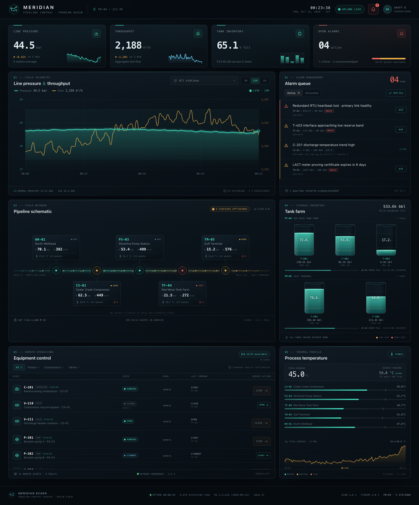

# Meridian SCADA

A live pipeline monitoring and remote-operations console for the fictional
Meridian / Permian Basin midstream network. The dashboard streams pressure,
throughput, tank inventory, process temperature, alarms and remote equipment
state from a Spring Boot service into a dark, dense React control-room UI.



## Stack

| Layer | Technology |
| --- | --- |
| Runtime | Java 27 |
| Service | Spring Boot 4.2.0-M2, Spring Framework 7.1, Spring MVC + SSE |
| Persistence | Spring Data JPA + H2 2.5.252 (in-memory) |
| Console | React 19.3.1, TypeScript 7, Vite 8.3.5 |
| Charts | Hand-built SVG — no charting dependency |

> **React version note:** the brief asked for React 22. As of October 2026 the
> latest published React release is **19.3.1**; React 20–22 do not exist yet.
> The console therefore uses the current stable React. The application code
> avoids React-19-specific experimental APIs, so it can move to React 22 when
> that release ships.

## Quick start

Requirements: **Java 27**, **Node 22+** and npm. Maven is not required — the
repository includes the Maven wrapper.

```bash
./run.sh
```

The launcher installs frontend dependencies if needed, compiles the service,
and starts both processes. It auto-selects free ports starting at **8082** (API)
and **5173** (console), then prints the URLs:

```
Console  →  http://localhost:5173
API      →  http://localhost:8082/api/dashboard
Health   →  http://localhost:8082/actuator/health
H2       →  http://localhost:8082/h2-console
```

Pin the ports if you prefer:

```bash
BACKEND_PORT=8090 FRONTEND_PORT=5180 ./run.sh
```

Stop everything that was started by the launcher:

```bash
./stop.sh
```

`run.sh` records each session under `.run/`. The stop script terminates only
verified Meridian processes (and can also find an untracked session by scanning
this checkout). `./run.sh stop` is equivalent to `./stop.sh`.

Other modes:

```bash
./run.sh prod    # build the UI into the jar and serve everything from one port
./run.sh build   # build frontend + backend only
./run.sh stop    # stop all launcher sessions
./run.sh help
```

`--dev`, `--prod` and `--build` are accepted as aliases for the three modes.

Run the backend tests with:

```bash
cd backend && ./mvnw test
```

For `prod`, the console and API share the backend port:
`http://localhost:<BACKEND_PORT>/`.

### H2 console

- JDBC URL: `jdbc:h2:mem:scada`
- User: `sa`
- Password: *(blank)*

The database is recreated on every start and seeded with one hour of historian
data, five stations, five tanks, twelve remote assets and a handful of alarms.

## What it does

- **Live line telemetry** — pressure, flow and temperature for five stations,
  driven by a 1 Hz mean-reverting simulation and pushed to the browser by SSE
  every 2 seconds.
- **Live/historical trending** — select any station or the whole line, and a
  5-minute, 15-minute or 1-hour window. History is read from H2; the latest
  samples are appended from the stream. Hover for a crosshair and exact readings.
- **Pipeline schematic** — a flow-animated route with per-station pressure,
  throughput, temperature, alarm and equipment state. Click a station to focus
  the trend.
- **Tank farm** — five tanks with animated fill levels, group inventory bars,
  reserve thresholds, capacity and headroom.
- **Alarm console** — severity counts, active/all views, per-alarm
  acknowledgement and acknowledge-all. Process alarms are deduplicated by rule,
  cleared automatically when the condition recovers, and stored in H2.
- **Remote equipment control** — start/stop pumps and compressors, open/close
  valves and reset faults. Commands require a confirmation dialog, invalid
  transitions return HTTP 409, and local-control assets cannot be operated
  remotely.
- **Thermal profile** — per-station temperature bars with warning/trip
  thresholds and a field-average trend.
- **Operational realism** — stopping a mainline pump or closing a flow-control
  valve collapses throughput within seconds and can raise low-flow alarms.
  Occasional pressure/temperature surges and equipment trips exercise the alarm
  path.

## Architecture

```
run.sh / stop.sh              verified session launcher and shutdown
frontend/                     React console (Vite dev server or built into the jar)
  src/components/             SVG charts, schematic, alarm/equipment panels
  src/hooks/useScadaFeed.ts   REST bootstrap + EventSource stream
  src/hooks/useTrends.ts      historian fetch + live point appending
backend/
  src/main/java/com/meridian/scada/
    domain/                   JPA entities and enums
    repository/               Spring Data repositories
    service/
      SimulationEngine       1 Hz telemetry simulation
      AlarmService           rule evaluation, hysteresis and acknowledgement
      DashboardService       snapshot aggregation for REST/SSE
      TelemetryHistoryService historical trend queries and downsampling
      StreamService          SseEmitter fan-out
      EquipmentService       validated remote command transitions
      FleetState             in-memory working set, batched persistence
    web/                     REST controllers, DTOs and error handling
```

Telemetry samples are written to H2 every 5 seconds and pruned after three
hours. Tank and equipment state changes are flushed in batches; commands are
persisted immediately. The active alarm count is computed from persisted alarm
state, not a client-side heuristic.

## API

| Method | Path | Purpose |
| --- | --- | --- |
| `GET` | `/api/dashboard` | Full operating snapshot |
| `GET` | `/api/trends?minutes=15&siteId=` | Historical trend, optionally scoped to a station |
| `GET` | `/api/stream` | SSE `snapshot` events, 2-second cadence |
| `GET` | `/api/alarms` | Recent alarm records |
| `POST` | `/api/alarms/{id}/acknowledge` | Acknowledge one alarm |
| `POST` | `/api/alarms/acknowledge-all` | Acknowledge all unacknowledged alarms |
| `GET` | `/api/equipment` | Remote asset registry |
| `POST` | `/api/equipment/{id}/command` | `{"action":"START\|STOP\|OPEN\|CLOSE\|RESET"}` |
| `GET` | `/actuator/health` | Service, database and disk health |

## Notes

- The UI is responsive down to phone widths; the schematic and equipment table
  scroll horizontally on narrow screens.
- Motion is disabled automatically under `prefers-reduced-motion`.
- The service binds to `--server.port` passed by `run.sh`; direct jar runs use
  `SERVER_PORT` (default `8082`).
